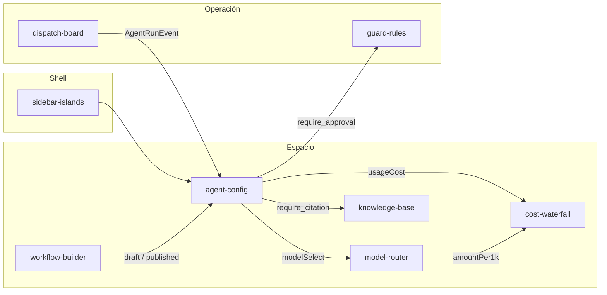

# Kit: consola de agentes del CRM

Marca de ejemplo: **Nimbo**. Nada de esto importa ramas que todavía no están en `CPL`.

## Mapa

| Sección del sidebar | Pieza | Estado en CPL | PR |
| --- | --- | --- | --- |
| Espacio · Configuración de agentes | `agent-config` | Esta rama | draft contra CPL |
| Espacio · Modelos | `model-router` | Rama `cursor/model-router-ad58`, sin merge | [#70](https://github.com/eduardoretana/retana-ui/pull/70) |
| Espacio · Uso y costo | `cost-waterfall` | No está en `origin` al 2026-11-06 | — |
| Espacio · Constructor de flujos | `workflow-builder` | No está en `origin` al 2026-11-06 | — |
| Espacio · Conocimiento | `knowledge-base` | No está en `origin` al 2026-11-06 | — |
| Operación · Corridas | `dispatch-board` | No está en `origin` al 2026-11-06 | — |
| Shell | `sidebar-islands` | No está en `origin` al 2026-11-06. La demo usa `Sidebar` de CPL | — |
| Administración · Guardas de herramientas | `guard-rules` | Rama `cursor/herramientas-guard-rules-ea36`, sin merge | [#65](https://github.com/eduardoretana/retana-ui/pull/65) |

`agent-config` deja tres slots tipados: `navigation`, `usageCost`, y `modelSelect` / `fallbackSelect`.

## Contratos a unificar al mergear

### Version

| Aquí | En las otras piezas |
| --- | --- |
| `AgentVersion.state`: `"draft" \| "published"` | `guard-rules` separa `Ruleset` (publicado, con `version`) y `RulesetDraft` |
| `number`, `author`, `at` (ISO) | `Ruleset.version` es solo el número |

Propuesta común: un registro con `state`, `number`, `author` y `at`. Un ruleset publicado es `state: "published"`.

### Run events

`AgentRunEvent.kind`: `decision | guardrail | fallback | test`.

`dispatch-board` debería alimentar `EvaluationSummary.distribution` (conteos de confianza 0–100). Esta consola no guarda la bitácora.

### Pricing

| Aquí | model-router (#70) | cost-waterfall (aún no en origin) |
| --- | --- | --- |
| `inputPerMillion` y `outputPerMillion`, `example: true` | `ModelMetrics.amountPer1k` | Cuatro tarifas por 1M: input, output, cache read, cache write |
| `exampleAmountPer1k` (mezcla 3/4 input, 1/4 output, dividido entre 1000) | `blendCostPer1k` solo pondera shares | El núcleo que debe producir el `amountPer1k` |

Esta pieza no cobra y no convierte divisas. La moneda viaja en `currency` (`USD` en la demo).

### Guardrail / Guard

| `Guardrail.action` | `DecisionKind` de guard-rules |
| --- | --- |
| `allow` | `allow` |
| `require_approval` | `require_approval` |
| `block` | `block` |
| `redact` | No hay equivalente. Es un paso previo al modelo, no una decisión terminal. |
| `require_citation` | No hay equivalente. Lo más cercano es `require_approval` o una decisión nueva. |

Condiciones de esta pieza que ya caben en `Condition` de guard-rules: `eq`, `gt` (el umbral sale de `params`, no va fijo en la condición) y `missing`. `always` es local.

`ApprovalHandoff` no es un `ApprovalTicket`. No abre el `ApprovalGate`.

### Approval

Un hit `require_approval` puede convertirse después en `ApprovalGate.create` con `reasonKey`, `rulesetVersion` = `AgentVersion.number` y, si existe, `threshold`. Los estados `pending | approved | rejected | expired` siguen siendo del gate, no de esta pantalla.

## Orden de integración

1. Unificar `Version` (`draft | published`) cuando `guard-rules` entre a CPL.
2. Sustituir el `Select` de modelo por `model-router` vía `modelSelect` / `fallbackSelect`. El id del modelo ya es el de `ModelRoute`.
3. Montar `cost-waterfall` en `usageCost`. Hasta entonces el botón solo entrega el gasto de ejemplo.
4. Hacer que `require_approval` abra un ticket del `ApprovalGate` en vez de quedarse en el resultado de la prueba.
5. Dejar que `knowledge-base` resuelva la guarda `require_citation`.
6. Conectar `dispatch-board` para llenar la distribución de 30 días con `AgentRunEvent`.
7. Cambiar el slot `navigation` de la demo (`Sidebar` de CPL) por `sidebar-islands` cuando esa pieza exista.

